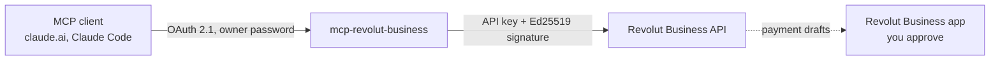

# mcp-revolut-business

A self-hosted [Model Context Protocol](https://modelcontextprotocol.io) server for Revolut
Business. Claude and other MCP clients can read the business's accounts, transactions,
counterparties, cards, team and expenses, and prepare payments that you approve in the Revolut
Business app.

- **One business, one owner.** A Revolut Business API key belongs to one business, so the server
  holds it and you sign in to the server with its password.
- **Signed requests.** Every request carries the API key and an Ed25519 signature made with the
  private key registered with it.
- **No surprise payments.** By default the server prepares payment drafts only. Direct payments,
  transfers and exchanges are opt-in with `REVOLUT_ALLOW_PAYMENTS`, and each carries an
  idempotency key so a retry cannot pay twice.

Start with [Getting started](getting-started.md).
